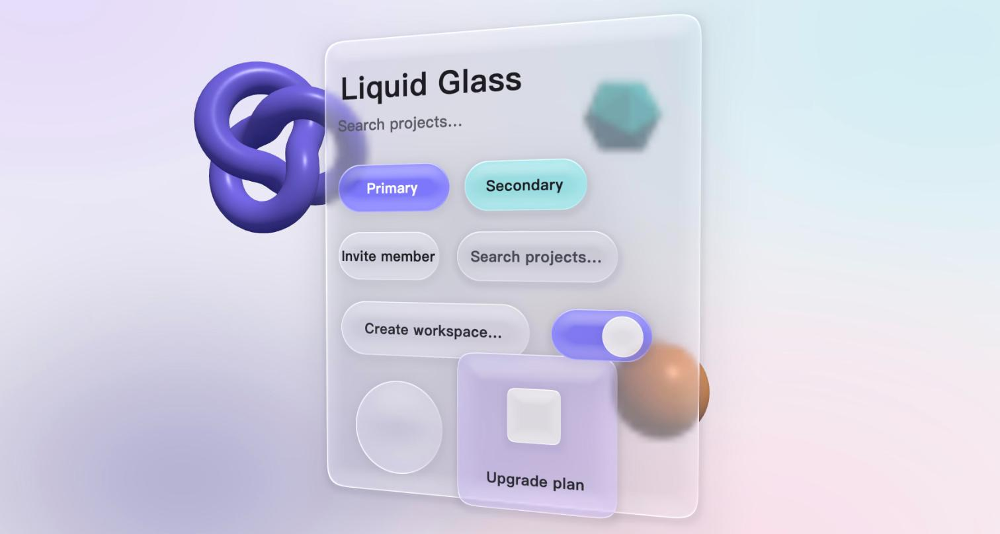
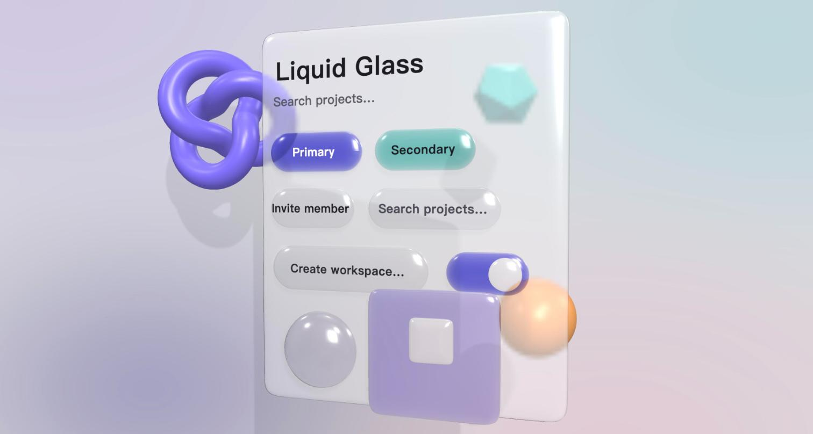
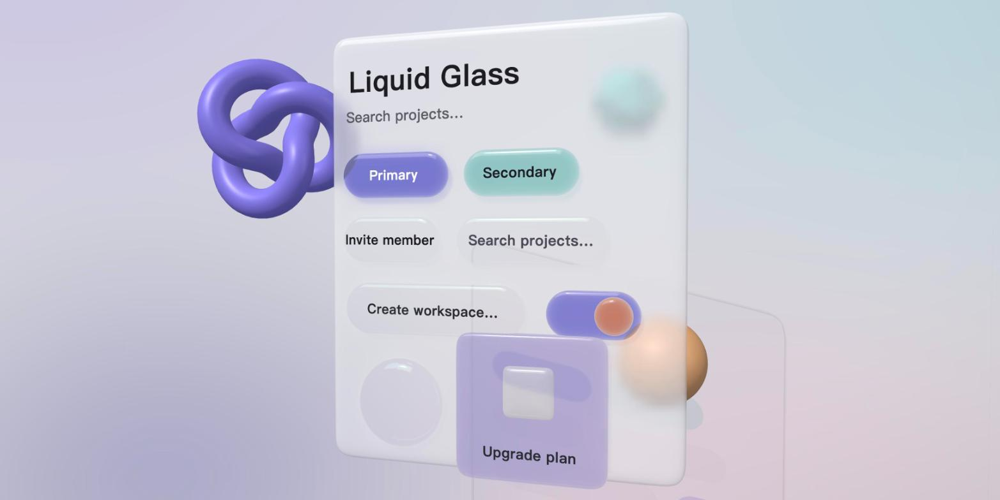
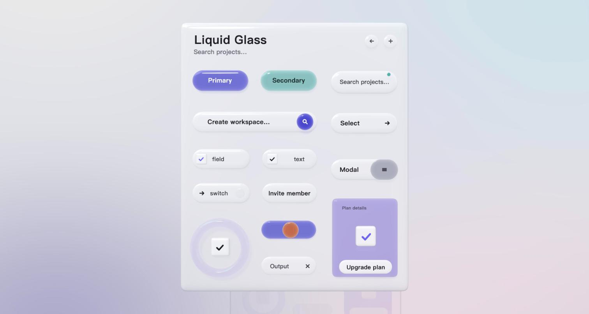
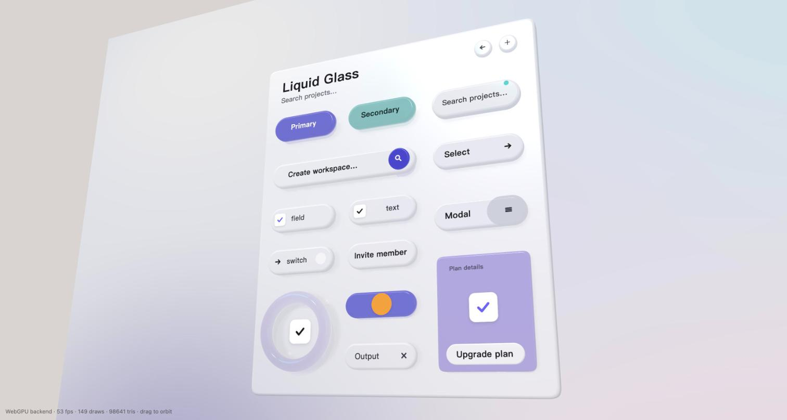
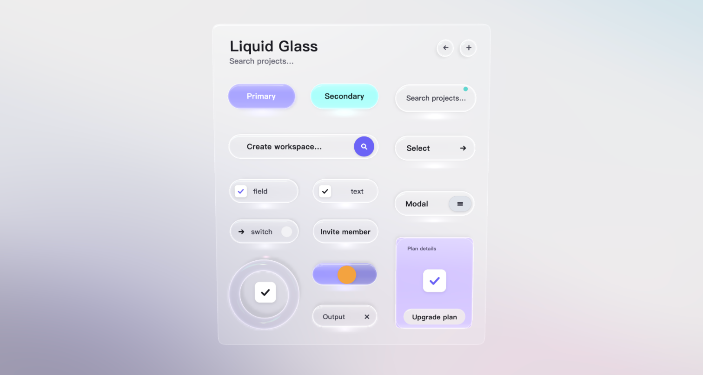
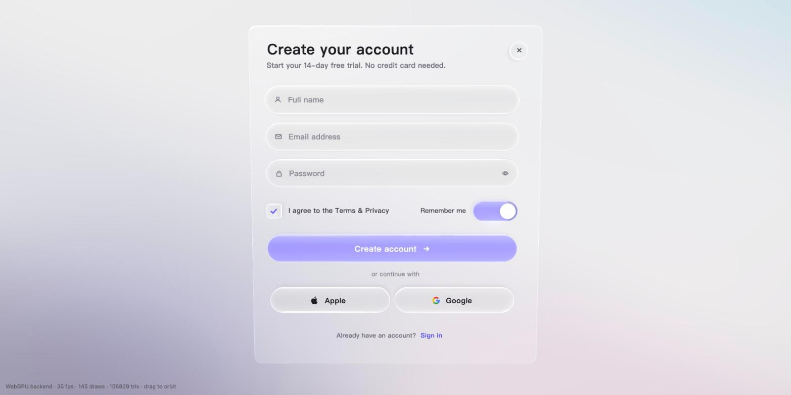

Look at the result first: "Open the concept" in the corner is a complete sign-up form drawn inside a three.js canvas, with no DOM elements at all. The buttons are transparent glass blocks with real thickness, the colour glows from inside the glass, shadows fall on the panel, and the panel reflects the buttons. Drag to turn it and see the depth.

It is the first sample of **ThreeDUI**, the 3D UI framework we are building in the open ([github.com/putcn/ThreeDUI](https://github.com/putcn/ThreeDUI)). Below: why we are doing this, and how that glass was changed, round by round.

## Why draw UI inside 3D space

Four reasons, in order of importance:

1. **Who writes the UI has changed.** Interface code is now mostly written by AI coding agents; people look at the result and give feedback. The old worry, "3D UI is too complex, nobody can maintain it", assumed a person was writing it. When an agent carries the complexity, we can afford a more complex, more explicit API in exchange for far more control than the DOM offers, as long as the documentation is clear enough for the agent.
2. **Expressiveness.** The DOM can only simulate thickness, light and material on a plane. Inside a 3D engine, thickness, refraction, reflection, shadows and perspective are real, and they share one light with everything else in the scene. This post will keep coming back to one lesson: **real things do not need tuning; fake things never stop needing it**.
3. **GPUs keep getting stronger.** Phone GPUs already hold scenes like this, with several full-screen samples per frame, shadow maps and planar reflections. three.js's WebGPURenderer falls back to WebGL2 automatically when WebGPU is unavailable, same code.
4. **Cross-platform.** Something drawn in a canvas looks the same in a browser, Electron, Tauri, any webview, even an XR headset, and interaction stays inside the canvas.

So the goal is: **a 3D component library you write with Vue syntax, whose containers can sit anywhere in a 3D scene, styled after Apple's Liquid Glass, covering the Tailwind set of basic components, developed in the open as a complete framework and UI standard.**

## First, how to render

Two rounds of research before touching code. In short:

- The most mature canvas UI library in the ecosystem (pmndrs/uikit) is WebGL-only, has no usable Chinese text, keeps its IME proxy off-screen, and its own v2 plans to rewrite the rendering layer. So we write our own core and borrow only its design.
- The renderer is three.js **WebGPURenderer + TSL**: one set of node materials, two backends, built-in backdrop sampling, so glass refraction is nearly free.
- Layout is Yoga (flexbox); the first text engine rasterises system fonts on demand into an atlas with Canvas2D (Chinese never misses a glyph); the IME follows Flutter web's approach of positioning a proxy input at the caret.

Then we started on the glass.

## Round one: 3D faked on a plane

The first version was a flat quad. A shader computed a signed distance field for the rounded rectangle, then derived edge height, normals, refraction offsets, dispersion and highlights from it. This is how CSS and SVG glass is done; it took three hours, and the WebGPU and WebGL2 backends matched pixel for pixel.

It was rejected, and rightly: **if we are already rendering in 3D space, thickness, highlights and shadows should be done in 3D, not simulated in 2D**. Every simulated feature needs another formula, and none of them will ever agree with the lighting of the other objects in the scene.

## Round two: real geometry, real light, real shadows

So the glass became a real mesh: the rounded outline extruded with thickness and a bevelled edge. The material is built on three.js's PBR node material, using its built-in `backdropNode` hook to replace the transmitted term. Highlights, Fresnel and environment reflections all come from the engine; we only write "the image seen through the glass". Shadows are variance shadow maps: buttons onto the panel, the panel onto the wall.

Before the first image there was a classic trap: the mesh winding was reversed, front faces were culled, and we were looking at the flat back face the whole time. It showed up as "no highlights no matter what we tune". A normal probe found it; one line fixed it.

The result was correct but looked like candy. Three reasons: the bevel was a full half-circle pillow; a clearcoat on top of strong environment reflection gave broad soft highlights, which is exactly what plastic looks like; and the scattering term was too heavy, so nothing was transparent.

## Rounds three to six: learning from the reference

The next rounds were all against one reference image. Each changed one concrete thing with a stated reason:

- **The thin bright line on the top edge** would not appear because the environment map was too uniform. A procedural studio environment (a large softbox top-left, a thin strip light below) gave the bevels something real to reflect, and the line appeared.
- **Coloured glass should pool coloured light beneath it.** Shadow maps are binary. I first wrote a pass that renders transmittance from the light's view, then found three.js supports coloured transmitted shadows natively (`shadowMap.transmitted` + `castShadowNode`), deleted mine and used the engine's.
- **The shadow on the back wall was removed.** Seen through a translucent panel it looked like dirt. UI elements only cast onto their own panel.

- The panel became milky frosted glass that no longer shows objects through it; the layout was rebuilt by measuring the reference element by element.

- **The button profile was wrong.** The reference is "a straight-cut thickness with a small round-over on the top face": crisp like a right angle, yet soft. The pillow became a fillet profile: vertical walls, 5 pt top radius, 3 pt bottom radius.
- **The panel should reflect the controls.** A planar reflection, blurred by frost, mixed in at a low ratio.
- **Not everything should be geometry.** Checkbox boxes, the switch knob and input icons became flat decals; it is cleaner.

## Round seven: crystal clear

By now the shapes were right but the material still read as cheap plastic. The cause was scattering: real glass scatters almost nothing; all of its visual information comes from refraction and edge reflection. So:

- Scattering down to 5%, round-overs on both the top and bottom edges, **back faces drawn before front faces** so the bright band on the lower edge and the internal reflections appear; Fresnel-weighted inner glow along the edges.
- Coloured elements stopped being solid absorbing colour and became **transparent glass with a pool of light of that colour inside**: the emissive term is weighted by Fresnel, so edges glow more, like a light box. The switch's left half lit and right half unlit is a soft split of that same material along uv, so no decal can ever overlap wrongly from any angle.
- An additive light pool under every element, plus a thin outline and a lower-edge highlight band.

The feedback on this round was "**a colour block below and an ultra-thin sheet of transparent glass on top works surprisingly well**". It is also the button structure we settled on: **glow layer + transparent glass shell + decoration layer**. Real 3D is responsible for shape, thickness, shadows, reflection and perspective; the handful of optical features that make glass look "crystal" are configurable decorations layered on the geometry.

## Rounds eight to eleven: a real interface

Finally the showcase elements were replaced with an actual sign-up form, and the remaining rounds were refinement: flatter side curves, the switch's glow boundary exactly at the knob's centre, one set of padding tokens (26 inset, 28 icon, 14 gap, group centring), a vector Apple mark, and a checkbox that is a 44 pt glass button. Those numbers became the defaults of the library's Button and Input.

## Next

The conclusions of these eleven rounds are in the framework's design document, and implementation is planned in three parts: a framework-agnostic core (node tree, styling, layout, events, text), the three.js render layer, and the Vue renderer with components. All of it is open at [github.com/putcn/ThreeDUI](https://github.com/putcn/ThreeDUI). Feedback is welcome, especially of the kind "this glass looks wrong here"; every improvement in this post came from exactly that.
